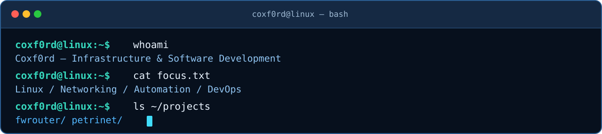
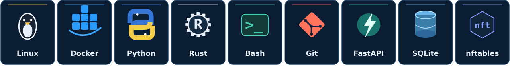
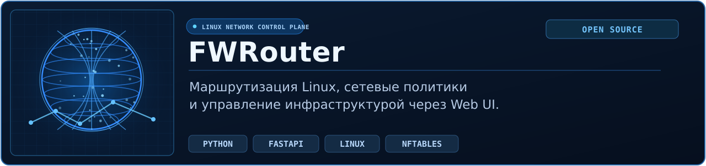
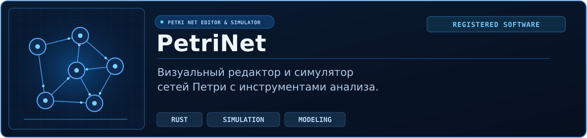

  

  &nbsp;
  

### `01 /` Обо мне

Разрабатываю программное обеспечение и инструменты для **Linux-систем, сетевой инфраструктуры и автоматизации**. Интересуюсь backend-разработкой, маршрутизацией трафика и DevOps-практиками. Главный интерес — инженерные задачи: от понимания архитектуры до развёртывания и диагностики.

  

### `02 /` Технологии и инструменты

  

**Инфраструктура:** `Linux` · `Docker` · `systemd` · `Bash` · `Git`  
**Разработка:** `Python` · `FastAPI` · `Rust` · `REST API` · `SQLite`  
**Сети:** `TCP/IP` · `DNS` · `DHCP` · `VPN` · `nftables` · `Policy Routing`

### `03 /` Избранные проекты

**[FWRouter](https://github.com/Coxf0rd/fwrouter)** — система управления сетевой маршрутизацией Linux. В проекте есть собственные Web UI и FastAPI Control Plane, управление `nftables` и policy routing, а также опциональные интеграции Mihomo и Xray.

**PetriNet** — настольное приложение на Rust для построения, исследования и имитационного моделирования сетей Петри. Соавтор программы, зарегистрированной в Роспатенте (№ 2026680027). Исходный код не находится в открытом доступе.

### `04 /` Текущие направления

<!-- Когда архитектурная схема будет готова, можно добавить её здесь:
### `05 /` Архитектура FWRouter

-->

---

Linux · Networking · Automation · Engineering

