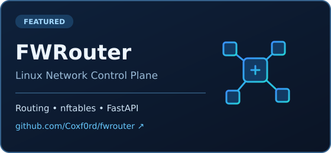
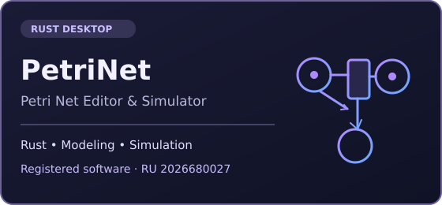

  

  
  

### Обо мне

Разрабатываю программное обеспечение и инструменты для **Linux-систем, сетевой инфраструктуры и автоматизации**. Интересуюсь backend-разработкой, маршрутизацией трафика и DevOps-практиками. Основной подход — решать практические инженерные задачи и разбираться в устройстве систем.

### `~/about` — терминал

  

### Технологии и инструменты

  
  
  
  
  
  
  

**Инфраструктура:** `Linux` · `Docker` · `systemd` · `Bash` · `Git`

**Разработка:** `Python` · `FastAPI` · `Rust` · `REST API` · `SQLite`

**Сети:** `TCP/IP` · `DNS` · `DHCP` · `VPN` · `nftables` · `Policy Routing`

### Избранные проекты

<table>
  <tr>
    <td width="50%" valign="top">
      
    </td>
    <td width="50%" valign="top">
      
    </td>
  </tr>
</table>

**[FWRouter](https://github.com/Coxf0rd/fwrouter)** — система управления маршрутизацией Linux с веб-интерфейсом, собственным Control Plane, поддержкой nftables / policy routing и опциональными VPN-интеграциями.

**PetriNet** — настольный редактор и симулятор сетей Петри на Rust. Соавтор зарегистрированной программы для ЭВМ (свидетельство № 2026680027); исходный код не опубликован.

### Сейчас в фокусе

`Linux administration` · `Docker / Compose` · `Bash automation` · `CI/CD` · `Network infrastructure`

---

  Linux • Networking • Automation • Practical engineering

