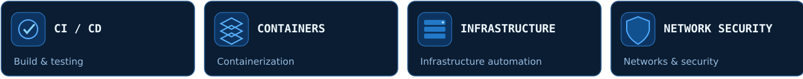

  

  &nbsp;
  

### `01 /` About Me

I build software and tools for **Linux systems, network infrastructure, and automation**. My interests include backend development, traffic routing, and DevOps practices. I focus on practical engineering work, from understanding the architecture to deployment and troubleshooting.

  

### `02 /` Technologies & Tools

  

**Infrastructure:** `Linux` · `Docker` · `systemd` · `Bash` · `Git`  
**Development:** `Python` · `FastAPI` · `Rust` · `REST API` · `SQLite`  
**Networking:** `TCP/IP` · `DNS` · `DHCP` · `VPN` · `nftables` · `Policy Routing`

### `03 /` Featured Projects

**[FWRouter](https://github.com/Coxf0rd/fwrouter)** — a Linux network routing control system featuring its own Web UI and FastAPI control plane, `nftables` and policy routing, and optional Mihomo and Xray integrations.

**PetriNet** — a Rust desktop application for creating, exploring and simulating Petri nets. Co-author of software registered with the Russian Federal Service for Intellectual Property (registration No. 2026680027). The source code is not public.

### `04 /` Current Focus

<!-- When the architecture diagram is ready, add it here:
### `05 /` FWRouter Architecture

-->

---

Linux · Networking · Automation · Engineering

